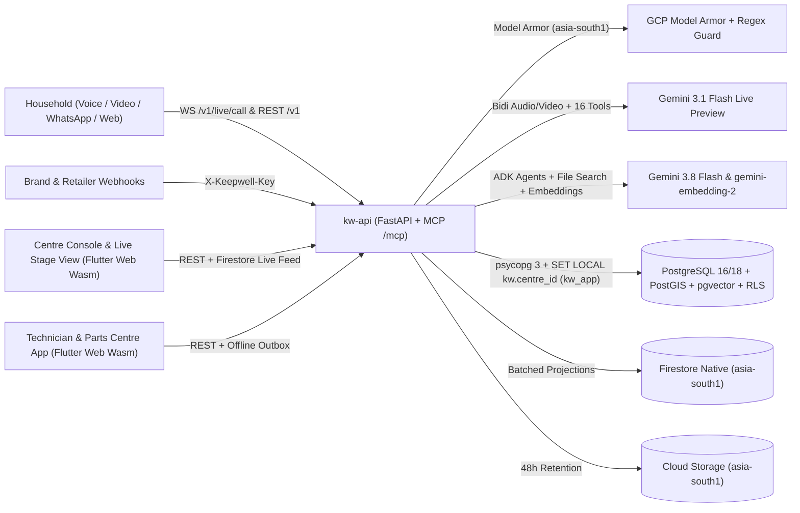

# Keepwell — Service-Centre & Brand After-Sales Agent Platform

Keepwell is an agentic platform that appliance service centres and brands deploy across India. It speaks in the name of the receiving service centre or brand (never as a consumer marketplace), handling four triggers (`household_call`, `household_message`, `brand_forward`, `retailer_handover`) across five appliance categories (`air_conditioner`, `refrigerator`, `washing_machine`, `water_purifier`, `water_heater`) in **English, Hindi, and Telugu**.

---

## Architecture Overview



---

## Quickstart (Local Merged Stack)

```bash
# 1. Seed PostgreSQL (unmodified keepwell_schema.sql + 55 CSVs = 15,465 rows + kw_app RLS)
make seed

# 2. Run all backend, mock, Dart, and Flutter unit/widget tests
make test

# 3. Run C2 contract conformance + C3 12 end-to-end journeys
make e2e

# 4. Run 20-case + 100-case evaluation harness (all 5 release gates)
make eval

# 5. Run production smoke suite
make smoke
```

See [docs/DEPLOYMENT.md](docs/DEPLOYMENT.md), [docs/ARCHITECTURE.md](docs/ARCHITECTURE.md), [docs/TEST_REPORT.md](docs/TEST_REPORT.md), [docs/RUBRIC_AUDIT.md](docs/RUBRIC_AUDIT.md), [docs/DEMO_SCRIPT.md](docs/DEMO_SCRIPT.md), and [docs/SUBMISSION.md](docs/SUBMISSION.md).
