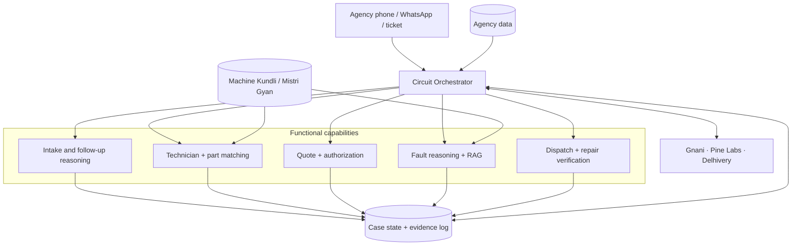
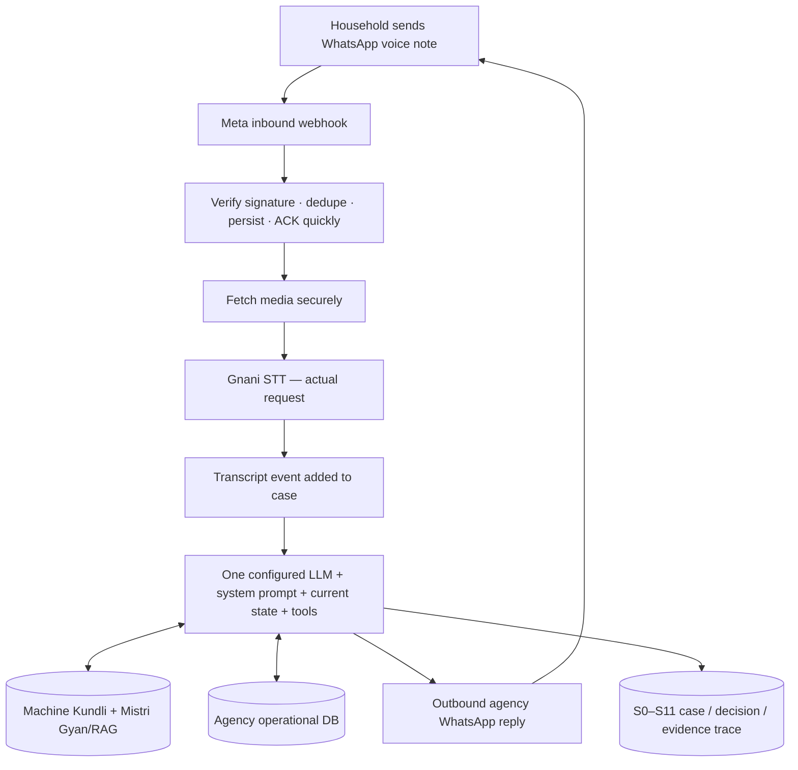
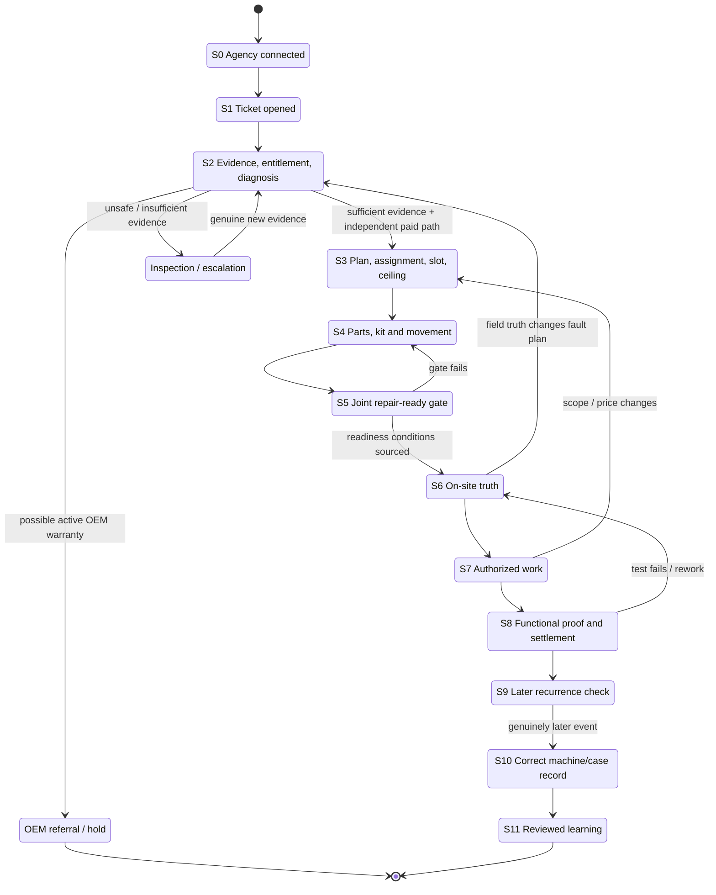

# CIRCUIT — Keeping the Machines Running
## Single-source build-ready design for mentor + engineering

**Team:** TripleIT  
**Competition:** The Ken Case Competition 2026, Round 3  
**Starting appliance:** Residential AC  
**Proposed company:** Circuit  
**Buyer:** Independent multi-brand repair agency  
**Entry point:** Agency’s connected WhatsApp Business number  
**First voice rail:** Gnani STT  
**Reasoning:** One configured Gemini OR Claude model  
**Knowledge:** Machine Kundli + Mistri Gyan + RAG + agency operational SQL  
**Technician:** Circuit ranks, agency assigns, household selects feasible slot  
**Payment:** payer-approved ceiling, settlement only after sufficient proof; simulated first  
**Logistics:** Delhivery Maps route simulation; agency-held kit in first story  
**Current status:** design/build handoff; live agent not yet proven

---

## 1. Problem

Today, a household may call a repair agency with a vague complaint. A technician travels to diagnose, may discover a missing part, returns to source it, and makes another visit. This creates uncertainty and downtime for the household, unproductive travel for the technician, and capacity/rework cost for the agency.

Circuit tries to improve **verified first-visit repair outcomes** by collecting useful evidence before dispatch, ranking plausible faults, preparing an appropriate technician/kit, getting explicit authorization and verifying what really happened afterward.

The business hypothesis is falsifiable:
pre-visit evidence → better fault hypotheses → better preparation → fewer avoidable repeat visits → more usable technician capacity and/or lower rework cost → better agency economics.

We do **not** currently have an India-wide first-visit-fix baseline or proof that every second visit is unpaid.

---

## 2. Complete strategic architecture

### Fourth knowledge rail

**Machine Kundli** = consented record for one machine:
brand/model/serial reference, warranty evidence, prior repairs, parts fitted, functional tests, later outcomes.

**Mistri Gyan** = reviewed collective repair intelligence:
permitted manuals/support passages, symptoms, error codes, discriminating tests, model applicability, fault relationships, compatible part evidence and reviewed outcomes.

**RAG** is one way the LLM retrieves relevant Mistri Gyan passages. RAG is not itself the whole fourth rail.

**Agency SQL** is separate:
technician skills, shifts, slots, actual agency assignment, prices, current inventory/holds and kit custody.

---

## 3. What actually triggers the agent

**The customer message is the trigger.**  
The system prompt is a rulebook loaded after an event arrives.  
A command prompt starts the server/tests only.

For audio, the state runner waits for the genuine Gnani result before diagnostic reasoning. A duplicate WhatsApp message must not trigger a second STT charge or second case.

---

## 4. One orchestrator, specialist tools

Use **one** LLM orchestrator for auditability and recording simplicity. The following are tools/modules, not necessarily independent LLM agents:

- Intake / adaptive question selector.
- Machine identity and entitlement.
- RAG retrieval.
- Fault hypothesis ranker.
- Safety/warranty gate.
- Technician skill matching.
- Availability/travel planner.
- Parts/compatibility/stock.
- Composite plan scoring.
- Quote and ETA.
- Payer authorization.
- Dispatch messaging.
- Field proof and closure.
- Learning/review queue.

The model chooses the next question or tool; deterministic policy code validates consequential actions.

---

## 5. S0–S11 canonical lifecycle

### S5 deterministic readiness predicates

For a **repair-ready** decision:
- work category/entitlement valid;
- safe scope;
- model/fault evidence adequate;
- technician eligible;
- agency actually assigned technician;
- technician accepted;
- customer selected a real offered slot;
- resident/access permission;
- compatible part/kit source if required;
- kit custody independently acknowledged;
- adult payer approved scope;
- simulated/real financial authorization appropriate to mode;
- pilot owner/senior-tech approval where required;
- route feasible.

If an exact part is not supported, the correct outcome is **inspection required**.

A synthetic inventory row does not prove a physical part is in a technician’s bag.

---

## 6. RAG design

We are **not training a new foundation model**.

### Knowledge ingestion
For every indexable passage record:
- source/document/chunk IDs;
- publisher;
- URL/file;
- rights/permission;
- captured/reviewed timestamp;
- appliance, brand, model scope;
- text;
- evidence tier;
- safety classification;
- limitation notes.

A URL in a source manifest is not automatically an indexed manual.

### Initial retrieval
Use SQLite FTS5 for simple, reproducible retrieval. Exact model numbers/error codes benefit from lexical search. Dense embeddings are optional later; do not call FTS5 a vector database.

### Retrieval rules
- filter by appliance / brand / model applicability;
- return source IDs and actual chunks;
- surface contradictions;
- generic support text can suggest safe follow-up questions;
- generic text cannot certify an exact replacement SKU;
- retrieved text cannot override the system prompt.

### Learning
S10 compares predicted vs actual.
S11 proposes reviewed updates.
Role-play/synthetic outcomes never become verified field knowledge automatically.

---

## 7. External rails

### Gnani — LIVE for voice

`POST https://api.vachana.ai/stt/v3`

- Header: `X-API-Key-ID`.
- Multipart: `audio_file`, `language_code`.
- REST clip max: 60 seconds; demo target ~15–30 seconds.
- Preserve exact response.
- No assumed confidence score.
- No machine-noise mechanical diagnosis from STT.
- Cache by WhatsApp message + audio hash.
- Internal demo-call cap protects limited credits; this cap is ours, not a claimed vendor quota.
- 403/429/provider failures → safe text fallback / blocked status, not invented transcript.

### Pine Labs — DOC_SIMULATED first

Use documentation-grounded authorization/payment responses supplied by the Wizard as external-world rail events.

Do not conflate:
- payer permission;
- mandate/link `CREATED`;
- active authorization;
- blocked reserve;
- final debit/capture;
- settlement.

No real money movement in the first simulation.

Core business rule: explicit ceiling first, potential final settlement only after adequate proof.

### Delhivery — DOC_SIMULATED first

Use Maps for documented address/routing/distance capability.

Maps does not provide:
- technician assignment;
- actual live technician position unless separately sourced;
- spare-part inventory;
- SKU compatibility;
- proof that part is in bag.

First story uses an agency-held synthetic kit plus independent role-play custody event. Delhivery One parcel shipment is outside the first demo.

### Meta WhatsApp — intended live channel

Must genuinely have:
- Meta app / WABA;
- test/business sender;
- token;
- phone number ID;
- app secret;
- webhook verification token;
- public HTTPS callback;
- message subscription;
- approved recipient rules.

Inbound delivery status must not be mistaken for a new customer message. Outbound API acceptance is not the same as delivered/read.

---

## 8. Main simulated story

A consenting participant role-plays a household in Ramagundam with an out-of-warranty AC cooling complaint.

Preloaded before T0:
- fictional agency;
- 2–3 fictional technicians;
- synthetic slots/prices;
- synthetic demo part/kit relationship;
- source-labelled safe AC knowledge;
- policies and role mappings.

Not preloaded:
- actual complaint words;
- Gnani transcript;
- customer follow-up answer;
- assignment approval;
- payer permission;
- technician acceptance/custody;
- repair outcome;
- later recurrence result.

Circuit may reach:
- `READY_IN_ROLEPLAY`;
- `NEEDS_INSPECTION`;
- `WAIT`;
- `OEM_REFERRAL`;
- `ESCALATE`.

It must not call a role-play AC a genuinely repaired household machine.

---

## 9. Recording

Two visible surfaces:
1. customer WhatsApp;
2. Circuit `/trace/{case_id}`.

Show:
- actual inbound event;
- actual Gnani request/result;
- LLM action + rule IDs;
- RAG chunk IDs;
- actual outbound WhatsApp request/status;
- agency/person messages;
- Pine doc-simulation;
- Delhivery doc-simulation;
- S5 predicate result.

A valid five-minute demo can stop at S5.
S9 cannot be one week later inside five minutes.

---

## 10. Business model

Circuit is a B2B agency software company.

Primary monetization hypothesis:
- agency subscription and/or usage;
- prove value before per-success pricing.

Agency value depends on:
- avoided unproductive repeat trips;
- freed technician time;
- filled demand;
- contribution per incremental repair;
- rework/callback cost;
- Circuit voice/LLM/messaging/support cost.

We must measure who actually bears second-trip cost. Public service prices are not automatically agency savings.

---

## 11. Risks

- wrong diagnosis / unsafe certainty;
- no exact compatible part evidence;
- stale inventory;
- poor agency adoption;
- low willingness to pay;
- WhatsApp onboarding complexity;
- Gnani transcription errors / credits;
- payment trust and eligibility;
- warranty/OEM restrictions;
- fake learning from synthetic data;
- no real demand to monetize freed capacity;
- privacy/consent / cross-agency knowledge rights.

---

## 12. Three imagined-capability budget

The competition permits up to three capabilities that do not exist yet.

Conservative accounting:
1. Shared Machine Kundli network.
2. Shared Mistri Gyan learning network.
3. Leave one capacity unused unless a genuinely valuable rail gap must be proposed.

No fictional Gnani/Pine/Delhivery endpoint is required.

---

## 13. What is build-ready versus unverified

**Specified:**
- architecture;
- state machine;
- runtime policies;
- data model;
- integrations;
- RAG;
- recording;
- test scenarios.

**Must still be built/tested:**
- Meta webhook;
- real Gnani request;
- selected LLM runtime;
- rights-cleared source ingestion;
- role mappings;
- operator trace;
- real participant flow;
- partner doc-simulation input;
- full recording.

The first engineering milestone is:
**real WhatsApp audio → real Gnani transcript → one LLM chooses a grounded follow-up → actual WhatsApp response → full audit trace.**
